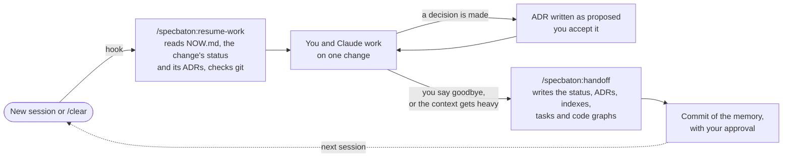
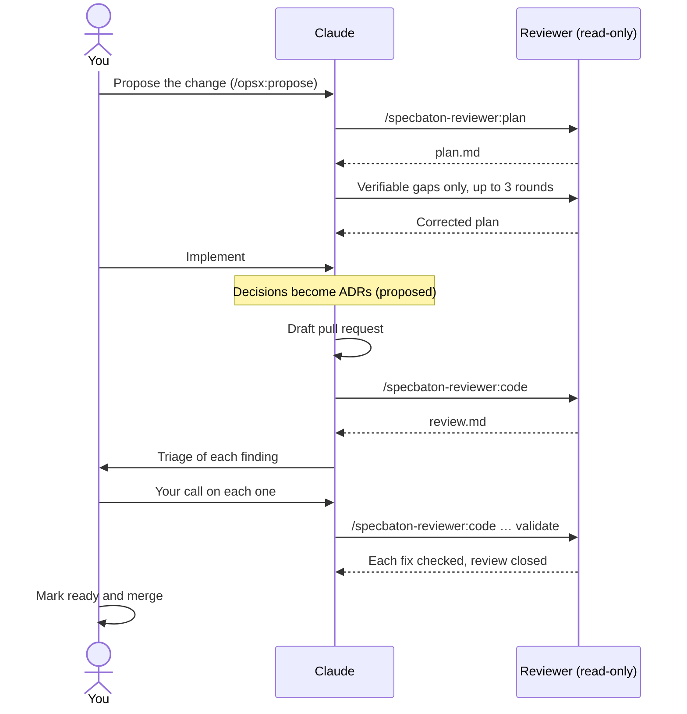

<p align="center">
  <picture>
    <source media="(prefers-color-scheme: dark)" srcset="assets/logo-dark.svg">
    
  </picture>
</p>

<p align="center">
  Spec-driven development with Claude Code, passed like a baton:<br>
  from one session to the next, and from the agent that implements to an agent that reviews.
</p>

<p align="center">
  <a href="LICENSE"></a>
  
  
</p>

SpecBaton is two [Claude Code](https://code.claude.com) plugins that install separately:

- **`specbaton`** keeps the work's memory in versioned files, so a compaction or a new chat loses nothing: decisions as ADRs, one change per session, and two rituals, resume-work and handoff, triggered by hooks. It works on its own.
- **`specbaton-reviewer`** adds a second agent, run from the command line, that writes the implementation plan before Claude implements and reviews the diff afterwards. It only reads, and a wrapper proves it with a git snapshot. It can be Cursor, Antigravity, Claude with another model, or any CLI you configure.

## Why

Long agent chats get compacted (Claude Code summarizes the conversation when the context fills up), and the first thing a summary drops is *why*: the alternatives that were ruled out. A new chat then reopens decisions that were already made. And when the same model implements and reviews, its blind spots repeat. SpecBaton answers those three problems with four ideas:

1. **Files are the memory.** The present lives in `NOW.md` and a status file per change; decisions live in ADRs (Architecture Decision Records: one short file per decision, with the alternatives that were rejected). A new session resumes from them.
2. **The spec comes before the code.** Each piece of work is a *change*: proposal, specs, design and tasks, written with [OpenSpec](https://github.com/Fission-AI/OpenSpec) when the project uses it.
3. **A second opinion that can't touch anything.** The reviewer agent writes the plan and reviews the diff, read-only and verified.
4. **The human decides what can't be undone.** ADRs are proposed and you accept them; you decide each review finding, mark pull requests ready and merge.

## How it works

Every session works on one change, and starts and ends the same way:



The chat is RAM and the repo is disk: whatever must survive is in a file by the time the session ends.

## Quick start

Requires Claude Code (tested with 2.1), `git`, `python3` and `bash`, on macOS or Linux. Optional: [OpenSpec](https://github.com/Fission-AI/OpenSpec) for changes (`npm install -g @fission-ai/openspec@latest`; the reviewer's plan needs it), [graphify](https://pypi.org/project/graphifyy/) for code graphs (`pipx install graphifyy`), and `gh` and `jq` for the reviewer's learning step.

From your shell:

```bash
claude plugin marketplace add cvillanueva84/specbaton
claude plugin install specbaton@specbaton
claude plugin install specbaton-reviewer@specbaton   # optional
```

Or inside a Claude Code session: `/plugin marketplace add cvillanueva84/specbaton`, then `/plugin install specbaton@specbaton`.

Then, in your project:

1. `/specbaton:setup` detects the project's structure (several repos, a monorepo or a single repo), decides with you where the memory lives, and creates it. Every step is shown before it runs, and nothing is committed without your approval.
2. `/specbaton-reviewer:setup` (optional) finds the CLIs you have, asks which one reviews and with which models, creates your team's review skill, and tests it for real.
3. Start a new session. It opens with a summary of where things stand.

## Usage guide

### A change, from start to finish



Step by step, for your first change:

1. **Open a session in the project.** A hook asks Claude to resume: it reads `NOW.md`, says where you left off and waits. The first time, `NOW.md` is empty.
2. **Propose the change.** With OpenSpec, `/opsx:propose <what you want>` writes the proposal, specs, design and tasks under `openspec/changes/<change>/`. Without it, describe the change and Claude tracks it in its status file.
3. **Get a plan** (with the reviewer). `/specbaton-reviewer:plan <change>`: the reviewer writes `plan.md`, and Claude sends back only what it can prove is missing (a scenario the plan doesn't cover, a path that doesn't exist), for up to 3 rounds.
4. **Implement.** Work as usual. When you settle a decision, Claude writes it as an ADR with `status: proposed`; you change it to `accepted` when you agree. Accepted ADRs aren't contradicted later: a new ADR supersedes them.
5. **Get a review** (with the reviewer). Open a draft pull request, then `/specbaton-reviewer:code <change>`: the reviewer writes `review.md`, Claude adds a triage, and you decide each finding. After the fixes, `/specbaton-reviewer:code <change> validate` checks each one until the review closes.
6. **Close the session.** Say goodbye ("that's all for today", "hasta mañana"…) or run `/specbaton:handoff`. Claude writes the status, the ADRs, the indexes and the tasks, and proposes the commit of the memory.
7. **Next day.** Open a new session: it resumes from the files, not from a summary of the chat.

Two habits make it work:

- **One change per session.** To switch topics, run `/specbaton:handoff`, then `/clear`.
- **Teach the reviewer.** When the team comments on the pull request, `/specbaton-reviewer:code <change> learn` finds what humans caught that the agent missed and proposes improvements to the review skill.

## Commands

| Command | When | What it does |
| --- | --- | --- |
| `/specbaton:setup` | Once per project, and again after an update | Detects the structure, creates the memory layer and `.claude/specbaton.json`. In a project already set up, offers only what's missing or new |
| `/specbaton:resume-work [change]` | A hook asks for it at the start of every session; also by hand | Offers to commit what an earlier handoff left uncommitted, reads `NOW.md`, the change's status and its ADRs, checks git since the last handoff, and summarizes |
| `/specbaton:handoff [change]` | When you say goodbye (a hook asks for it), when the context gets heavy, or before switching changes | Writes the status, creates the missing ADRs as `proposed`, updates the indexes, tasks and code graphs, and proposes the commit |
| `/specbaton-reviewer:setup` | Once per project | Chooses the reviewer CLI and models, creates the review skill, runs three real read-only tests |
| `/specbaton-reviewer:plan <change>` | Right after proposing a change | The reviewer writes `plan.md`; Claude sends back only verifiable gaps, up to 3 rounds in the same conversation |
| `/specbaton-reviewer:code <change>` | Right after opening a draft pull request | The reviewer reviews the diff; Claude adds a triage where you decide each finding |
| `/specbaton-reviewer:code <change> validate` | After the fixes | The reviewer validates each fix in the same conversation, until the review closes |
| `/specbaton-reviewer:code <change> learn` | When the team comments on the pull request | Classifies what humans found that the agent missed, and proposes improvements to the review skill |

## The memory

```text
<memory layer>/
├── NOW.md                 active epics and changes; the session's starting point
├── decisions/
│   ├── README.md          one line per ADR
│   └── 0001-….md          one decision per file: proposed → accepted → superseded
├── templates/adr.md
└── docs/reference/        operational reference, read on demand
openspec/changes/<change>/
├── status.md              a snapshot of the present, not a diary
├── plan.md                from the reviewer (optional)
└── review.md              from the reviewer (optional)
```

Where the memory layer lives depends on the project. `/specbaton:setup` detects it and asks:

| Layer | For | What it does |
| --- | --- | --- |
| **W**, workspace | A folder with several repos | The root becomes a private git repo whose `.gitignore` allows only the memory files; the team repos stay untouched |
| **A**, in the repo | Your own repo, or one whose team adopts the memory | The memory lives in the repo |
| **B**, beside the repo | A team repo you don't want to change | The memory lives in a private repo beside it; the rules go in `CLAUDE.local.md`, kept out of git, and each change's status in `<memory>/status/` |

The setup never adds a remote to a memory repo: it may hold your company's content, so where it's pushed is your call.

Rules for ADRs: the rejected alternatives are required (they're what a summary drops), an accepted ADR is never contradicted (a new one supersedes it), and an accepted ADR's body is never edited.

### Code graphs (optional)

With [graphify](https://pypi.org/project/graphifyy/), each *unit* (a repo, a service or a package) gets a graph under `graphify-out/units/`, so Claude asks about the code's structure instead of reading it file by file. Besides each unit's graph there's a platform graph for questions that cross units: the units' graphs merged (`merge`, the default for several repos) or one graph of the whole root (`full`, the default for a monorepo, which keeps the real imports between units).

Units are discovered on every run: repos in a multi-repo folder, or folders with a `package.json`, `pyproject.toml`, `go.mod`… in a monorepo. A folder you add later gets its graph the first time a session works in it, since `/specbaton:handoff` refreshes the graphs of the units a session touched. The setup shows what it found and lets you leave units out (`exclude`) or add folders it missed (`include`).

### Obsidian (optional)

Open the memory layer as an [Obsidian](https://obsidian.md) vault for a dashboard of ADRs and changes (it uses the Dataview plugin, which you install). The setup sets the folders Obsidian leaves out of its search and graph view: always `graphify-out/`, plus the code folders you choose. It can also color the graph view by path: ADRs, changes, specs, status and each folder of yours in its own color.

## The reviewer

| `cli` | Tool | How it stays read-only | Resumes with |
| --- | --- | --- | --- |
| `cursor` | Cursor (`cursor-agent`) | `--mode=ask`, never `--force` | `--resume=<id>` |
| `agy` | Antigravity (`agy`) | Session-only `--settings` with deny rules for commands, writes, MCP and URLs | `--conversation <id>` |
| `claude` | Claude Code with another model | `--tools "Read,Grep,Glob"`, no MCP tools, no user or project settings (so no hooks or plugins) | `--resume <id>` |
| `custom` | Any CLI | Its own read-only mode | When it supports it; otherwise each round carries the previous output |

Whatever the CLI, the real guarantee is the wrapper's: a git snapshot of the root, every nested repo and an external memory layer before and after the run, plus a search for files changed during it. If anything changed, it stops with exit code 4 and reverts nothing.

A reviewer from another model family brings other blind spots. Claude reviewing Claude works, and still brings a session with no memory of how the code was written, but it shares more of them: pick at least a different model, and remember it spends from the same account.

The plan and the reviews live in the change's OpenSpec folder, so the reviewer works with OpenSpec changes.

**Privacy.** The memory plugin sends nothing anywhere: its hooks only add text to the session, and the code graphs are built locally, without a model. The reviewer is the exception: the diff, the specs and the files it reads go to the CLI you choose, under your own account with that tool. The wrapper masks the usual secrets in the diff (`.env`-style keys, PEM keys, known token prefixes), but check what you send. The learning step reads the pull request's comments with `gh`.

## Settings

Everything lives in `.claude/specbaton.json`, written by the setup skills:

```json
{
  "version": 1,
  "layer": "W",
  "memory_dir": ".",
  "rules_file": "CLAUDE.md",
  "status_path": "openspec/changes/{change}/status.md",
  "openspec": true,
  "graphs": {"enabled": true, "units": "auto", "exclude": [], "include": [], "platform": "auto"},
  "obsidian": true,
  "obsidian_colors": true,
  "cycle_rules": false,
  "farewell_patterns": [],
  "reviewer": {
    "cli": "agy",
    "plan_model": "…",
    "review_model": "…",
    "base": "origin/main",
    "skill": "acme-code-review",
    "exclude": [".obsidian"],
    "max_rounds": 3
  }
}
```

`farewell_patterns` adds goodbyes in other languages (regular expressions) to the built-in English and Spanish ones. A feature set to `false` was turned down, and a later setup doesn't ask about it again.

## Updating and uninstalling

Plugins from this marketplace don't update on their own unless you turn on auto-update for it (`/plugin`, **Marketplaces** tab). To update by hand:

```bash
claude plugin update specbaton@specbaton
claude plugin update specbaton-reviewer@specbaton
```

Then start a new session (or run `/reload-plugins`) and run `/specbaton:setup` again: it keeps what's there and offers only what's new. `claude plugin marketplace update specbaton` alone only refreshes the listing.

To uninstall, `claude plugin uninstall specbaton@specbaton`. Your memory files, the rules and `.claude/specbaton.json` stay: they're yours. Without the plugin, the rules' references to its commands simply go unused.

## Troubleshooting

- **A session doesn't open with a summary.** The hooks stay silent when there's no `.claude/specbaton.json` at or above the folder you opened, or when `python3` is missing. Run `/specbaton:resume-work` by hand, or `/specbaton:setup` if the project isn't set up.
- **The handoff doesn't run when you say goodbye.** Short goodbyes ("bye", "good night", "chao") count only at the start or end of a message, so "the goodbye screen has a bug" isn't one. Run `/specbaton:handoff`, or add your own phrases in `farewell_patterns`.
- **The reviewer stops with exit code 3** (the CLI isn't installed, signed in or trusting the folder), **4** (the agent changed files: nothing is reverted, and Claude shows what changed) **or 5** (another failure, with its log). The commands say which, and offer to go on without the reviewer when it can't run.

## Development

Version 0.4.0, early. See [CHANGELOG.md](CHANGELOG.md).

- `bash tests/hooks.test.sh` checks the memory plugin's hooks and settings with simulated hook inputs.
- `bash tests/setup.test.sh` checks how a second setup finds what's in place, what's missing and what's new.
- `bash tests/graphs.test.sh` checks how units are discovered for the code graphs, and builds real graphs when graphify is installed.
- `bash tests/reviewer.test.sh` checks the wrapper with fake CLIs for the four adapters: answers, resume flags, denied actions, writes inside repos and inside ignored folders, unknown models, usage limits and secret masking.
- `claude plugin validate .` checks the marketplace and each plugin's manifest.
- The read-only behavior of each real CLI was checked by hand in November 2026, against Cursor's CLI, Antigravity 1.5.1 and Claude Code 2.1.

Issues and pull requests are welcome. Run the tests before opening one.

## License

MIT. See [LICENSE](LICENSE).
